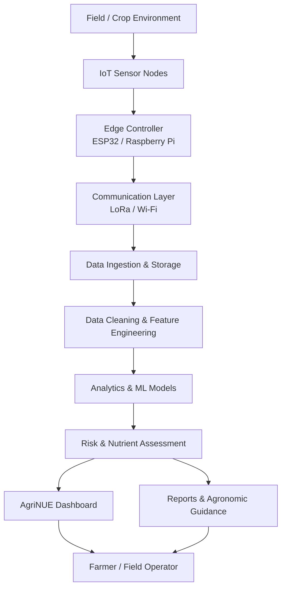

<!--
AgriNUE | Repository README
Keep project claims aligned with the implementation and validated research records.
-->

<div align="center">

# 🌱 AgriNUE

### Intelligence rooted in every field.

**An IoT-enabled, machine-learning-assisted precision agriculture platform for soil intelligence, nutrient-use efficiency, and climate-aware farm decision support.**

[](https://github.com/aayushmishra20/AgriNUE)
[](#)
[](#)

<br/>

*Turning field observations into actionable agricultural intelligence.*

</div>

---

## Overview

**AgriNUE (Nutrient Use Efficiency)** is an intelligent agriculture initiative that combines connected soil and environmental sensing, data analytics, and machine-learning-based decision support to help farmers make better-informed decisions.

The platform is designed to monitor important growing conditions, interpret field data, surface potential risks, and support more precise irrigation and nutrient management. Its broader research direction is **AgriNUE-IntelliFarm** — a weather-synchronized framework for prescriptive nutrient management and climate-adaptive agriculture, with a focus on making data-driven tools accessible to resource-constrained farmers.

The project brings together three layers:

- **Field intelligence:** IoT sensors collect soil and environmental observations.
- **Data intelligence:** Data processing, visualization, and analytical models help identify patterns and risks.
- **Decision support:** A farmer-facing interface presents indicators, reports, and agronomic guidance.

> **Project status:** This repository currently contains a browser-based AgriNUE interface and supporting JavaScript/CSS assets, along with a sensor-data CSV. The broader sensor-network and machine-learning research described below represents the project/research direction; not every research component should be interpreted as a production integration in this repository.

## At a glance

| Dimension | Project details |
|---|---|
| Application | Precision agriculture and nutrient-use efficiency |
| Research framework | AgriNUE-IntelliFarm |
| Field context | Haryana, India; field activities have included villages in the Sonipat region |
| Core inputs | Soil nutrients, pH, moisture, temperature, humidity, light and environmental observations |
| Connectivity direction | ESP32 / Raspberry Pi edge devices with LoRa-based sensor communication |
| Analytics direction | Data analysis, predictive modelling, risk estimation and nutrient-management optimization |
| Interface in this repository | HTML, CSS and JavaScript |
| Data asset | `sensor_data.csv` |
| Primary objective | Better-informed, efficient and climate-aware farm management |

## Why AgriNUE?

Agricultural decisions are often made with incomplete information about soil conditions, nutrient availability, moisture distribution, and changing weather. Applying more fertilizer or water does not necessarily solve the underlying problem; it can increase costs and contribute to inefficient resource use.

AgriNUE is being developed to address this gap by connecting field measurements with understandable analytics and actionable recommendations.

### Design goals

- Improve visibility into soil and crop-environment conditions.
- Support nutrient-use efficiency (NUE) through data-informed nutrient management.
- Identify conditions that may contribute to nutrient lockout or crop stress.
- Support irrigation decisions using soil-moisture observations.
- Incorporate weather context into farm decision support.
- Present technical measurements in a farmer-oriented interface.
- Explore accessible deployment approaches for small and economically weaker-section (EWS) farmers.

## Platform capabilities

The current web interface is organized around the following user-facing areas:

| Module | Purpose |
|---|---|
| **Home** | Introduces the AgriNUE vision, research focus and platform objectives. |
| **Dashboard** | Presents soil nutrient indicators, environmental readings and farm telemetry views. |
| **Reports** | Provides a detailed view of soil health, telemetry and NUE-related indicators. |
| **Assistance** | Presents agronomic guidance concepts, alerts and suggested actions. |
| **Login / Profile** | Provides the interface for user access and profile-related flows. |

The dashboard and report pages include charting/data-visualization components and CSV parsing dependencies. Actual values depend on the data and integrations available to the running application. Illustrative interface values should not be treated as live field readings.

## System architecture

The intended AgriNUE architecture connects field-level sensing to data processing and farmer-facing decision support.



*Architecture diagram describes the target system workflow; deployment topology and integrations may vary by prototype stage.*

## IoT and sensing layer

The research and prototype work has explored a combination of soil, environmental, and edge-computing components.

### Measurement categories

| Parameter | Why it matters |
|---|---|
| Nitrogen (N), Phosphorus (P), Potassium (K) | Soil nutrient status and nutrient-management decisions |
| Soil pH | Soil acidity/alkalinity and nutrient availability |
| Soil moisture | Irrigation planning and root-zone water availability |
| Soil / ambient temperature | Crop and soil environmental context |
| Relative humidity | Environmental monitoring and disease-risk context |
| Light intensity | Crop-environment monitoring |
| Air-quality / gas indicators | Exploratory environmental monitoring |

### Hardware explored

- **Controllers and edge devices:** ESP32, Raspberry Pi 4 Model B (8 GB), and NVIDIA Jetson Nano.
- **Connectivity:** LoRa modules (including RFM95), Wi-Fi and supporting wireless modules.
- **Sensors:** NPK, soil pH, soil-moisture, temperature/humidity, light-intensity and selected gas/air-quality sensors.
- **Additional prototype components:** ESP8266, HC-05 and SIM7000E communication modules.

The exact sensor configuration is prototype-dependent. Sensor readings require calibration, unit validation, and field/laboratory checks before they are used for agronomic recommendations.

## Research and machine-learning direction

The research track, **AgriNUE-IntelliFarm**, explores a weather-synchronized machine-learning framework for prescriptive nutrient management in climate-adaptive agriculture.

### Research themes

1. **Soil and environmental monitoring** — collect time-series observations from distributed sensor nodes.
2. **Weather synchronization** — contextualize field observations with meteorological information.
3. **Predictive analysis** — investigate temporal and gradient-boosting approaches for agricultural indicators.
4. **Risk estimation** — estimate potential soil, crop-environment, and nutrient-management risks.
5. **Prescriptive optimization** — explore multi-objective approaches to improve nutrient-use efficiency while accounting for field conditions.

### Models and methods explored

- Gradient Boosting / GBM approaches for structured prediction tasks.
- Long Short-Term Memory (LSTM) networks for temporal patterns.
- Probabilistic risk estimation.
- Multi-objective optimization for nutrient-use efficiency.
- Data preprocessing, feature engineering and time-series analysis.

These are research methods explored for the project; this README does not claim that every model is trained, deployed, or connected to the current web interface.

## Field research and data

Field activities and research planning have focused on the Haryana agro-climatic context, including work in the Sonipat region.

Project research records describe:

- Field interactions and farmer surveys in villages including Seoli and Nathupur.
- A sensor-network research design involving **25 sensor nodes**.
- A target sampling interval of approximately **10–15 minutes**.
- A **120-day** experimental observation window in the research plan.
- More than **23,000 sensor observations/readings** collected or used in project work.

These figures refer to project research activities and datasets, not a claim that all observations are currently streamed live by this GitHub application. Dataset provenance, collection dates, sensor calibration, missing-value treatment, and experimental metadata should accompany any formal scientific reuse.

### Data included in this repository

- `sensor_data.csv` — CSV data asset used by the project interface / analysis workflow.

Before using the CSV for independent research, inspect its column definitions, units, timestamps, collection context, and any anonymization or licensing requirements. Do not assume it is a fully documented public benchmark dataset.

## Technology stack

### Current repository interface

| Technology | Role |
|---|---|
| HTML5 | Page structure |
| CSS3 | Layout, styling and responsive presentation |
| JavaScript | Client-side interactions and data handling |
| Chart.js | Data visualization on report views |
| Papa Parse | CSV parsing in browser workflows |
| Lucide | Interface icons |
| Font Awesome | Icons used by the home page |

### Research / prototype ecosystem

| Area | Technologies and components explored |
|---|---|
| Edge / IoT | ESP32, Raspberry Pi, Jetson Nano |
| Connectivity | LoRa / RFM95, Wi-Fi |
| Data and analytics | Python, PostgreSQL, Apache Kafka and data-processing workflows |
| Machine learning | TensorFlow, PyTorch, GBM and LSTM approaches |
| Weather context | IMD data and weather API integrations |
| Visualization / prototyping | Streamlit and browser-based dashboards |

*The research ecosystem lists tools explored or planned across project work; it is not a dependency manifest for the current static web interface.*

## Repository structure

```text
AgriNUE/
├── home.html          # Project landing page
├── dashboard.html     # Farm and soil monitoring dashboard
├── dashboard.css      # Dashboard styles
├── dashboard.js       # Dashboard interactions and data handling
├── report.html        # Analytics and reporting interface
├── report.css         # Report page styles
├── report.js          # Report and chart logic
├── analysis.html      # Agronomy assistance interface
├── analysis.css       # Assistance page styles
├── analysis.js        # Assistance page logic
├── login.html         # Login interface
├── login.css          # Login styles
├── login.js           # Login interactions
├── profile.html       # User profile interface
├── profile.css        # Profile styles
├── profile.js         # Profile interactions
├── style.css          # Landing page styles
├── script.js          # Shared landing page interactions
├── plant.png          # Landing-page visual asset
└── sensor_data.csv    # Sensor data CSV
```

## Run locally

This repository currently uses a browser-based HTML/CSS/JavaScript interface. No frontend build step is required for the basic static pages.

### Option 1: Open directly

1. Clone the repository.
2. Open `home.html` in a browser.

```bash
git clone https://github.com/aayushmishra20/AgriNUE.git
cd AgriNUE
```

### Option 2: Run a local development server

Using Python:

```bash
python3 -m http.server 8000
```

Then visit:

```text
http://localhost:8000/home.html
```

Some browser features, authentication flows, or external CDN dependencies may behave differently when opened directly from the filesystem. Use a local server for a more reliable preview.

## Roadmap

- [ ] Document sensor hardware wiring, pin maps and calibration procedures.
- [ ] Publish a data dictionary for `sensor_data.csv` with units and provenance.
- [ ] Formalize the sensor-ingestion and storage pipeline.
- [ ] Integrate verified weather observations with field telemetry.
- [ ] Document reproducible ML training, validation and evaluation procedures.
- [ ] Connect validated model outputs to the dashboard and assistance modules.
- [ ] Add field-trial protocols, crop details and experimental design.
- [ ] Add deployment instructions and system-level architecture documentation.
- [ ] Provide farmer-oriented guidance in accessible regional languages.

## Research publication

**Research framework:** *AgriNUE-IntelliFarm: A Weather-Synchronized Machine Learning Framework for Prescriptive Nutrient Management in Climate-Adaptive Agriculture.*

Publication metadata, DOI, paper link, and final bibliographic details can be added here once the public record is available.

## Responsible use and research limitations

AgriNUE is a research and prototype initiative. Soil sensor readings can vary with soil texture, salinity, placement depth, moisture, calibration, and sensor quality. Nutrient recommendations must be validated against crop-specific agronomic standards, local soil-laboratory results, and expert guidance.

Do not use illustrative dashboard values or unvalidated model outputs as the sole basis for fertilizer, pesticide, or irrigation decisions. The platform is intended to support—not replace—qualified agronomic judgment.

## Team and acknowledgement

AgriNUE has been developed as an academic and applied-research initiative associated with **SRM University Delhi-NCR, Sonipat**, with a focus on practical precision-agriculture applications.

For project-related enquiries and collaboration:

- **Email:** ngatsolutions01@gmail.com
- **Institution:** SRM University Delhi-NCR, Sonipat, Haryana

## Contributing

Contributions, research feedback, and implementation suggestions are welcome.

1. Fork the repository.
2. Create a focused feature branch.
3. Document relevant hardware, data, or model assumptions.
4. Test changes against the existing browser interface.
5. Open a pull request describing the change and its validation.

## License

No license file is currently declared in this repository. Unless a license is added by the repository owner, reuse and redistribution are not automatically granted. Add an appropriate license before inviting external reuse.

---

<div align="center">

**AgriNUE — Intelligence rooted in every field.**

*Building toward more informed, efficient, and climate-adaptive agriculture.*

[Repository](https://github.com/aayushmishra20/AgriNUE) · [Report an issue](https://github.com/aayushmishra20/AgriNUE/issues)

</div>
